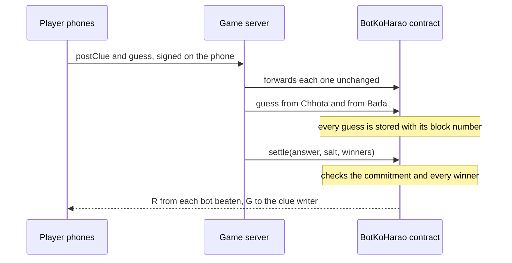

# Bot ko Harao

**A room full of phones against two AI bots. Beat a bot, and a contract on Monad pays you from its prize pool.**

TODO: screenshot of the big screen in the middle of a round

| | |
|---|---|
| **Play it** | TODO: hosted URL |
| **Contract** | [`0xe28e2E3eF788CF38dE8623e7173406b4C9673D14`](https://testnet.monadvision.com/address/0xe28e2E3eF788CF38dE8623e7173406b4C9673D14) on Monad testnet (chain ID 10143). Source verified on Sourcify. |
| **Demo video** | TODO |
| **Product video** | TODO |
| **Post** | TODO |

Built at Monad Blitz Pune V3.

## The bet

AI is good at word games, but it is not perfect. In our bench run the small bot got 7 of 30 clues wrong and the big one got 3 of 30 wrong ([results](docs/bench-test-run.md)). A person who knows the room can write a clue that people get and a model misreads. This game pays for exactly that moment, and the payment is enforced by a contract instead of a host.

## How a round works

1. **Join.** Scan the QR code on the big screen. The phone creates a burner wallet in the browser and its address becomes the player ID. The game sends that wallet a little MON for gas. No app and no sign-up.
2. **Write (30 s).** Each player sees four words, one of which is theirs, and writes a clue for it. A clue is at most 6 words and 40 characters and cannot contain any of the four words.
3. **Guess (up to 4 slots of 8 s).** Each phone gets someone else's clue and its four words. The two bots get the same clues.
4. **Reveal (15 s).** The answers come out and the winnings are settled.

The bots are Chhota (`openai/gpt-oss-20b`) and Bada (`openai/gpt-oss-120b`), both on Groq's free tier. Any OpenAI-compatible endpoint works. A bot that times out or errors counts as having given no answer.

## What happens on chain



The server proposes a result and the contract checks it. The server never chooses who gets paid or how much.

Each phone signs its own transactions with its burner wallet. The server forwards a transaction only if it is exactly the call the game expects from that player: the right signer, the right contract, the right data, no value, and a gas limit no higher than the measured one. It cannot change a signed transaction. Phones never talk to the RPC, so a full room is one connection to the chain and one WebSocket back to each phone.

- **`postClue`** stores a commitment to the answer, `keccak256(giver, round, answer, salt)`. The answer itself is not on chain until the round is settled. One clue per player per round.
- **`guess`** records the choice and the block number, once per player per clue. Nobody can guess their own clue.
- **`settle`** (operator only) reveals the answer and salt. The contract rejects the call if they do not match the commitment, or if any listed winner did not actually guess right.
- Each human who was right takes **R** from each bot they beat. A bot is beaten if it was wrong, did not answer, or answered in a later block. A tie in the same block goes to the human.
- If at least one human was right, the clue's writer takes **G** from each bot that was wrong or did not answer.
- **`fund(bot)`** adds MON to a bot's prize pool. Anyone can call it.
- **`withdraw`** pays a player their winnings. Bots cannot withdraw. The phone app shows winnings but has no withdraw button yet.
- **`dripMany`** forwards the caller's own MON to a list of addresses, so burner wallets have gas.

R and G are fixed when the contract is deployed. On the live contract R is 0.005 MON and G is 0.01 MON. A bot pays only what is left in its pool.

## Why Monad

- **A whole room writes at once.** A clue's ID is `keccak256(giver, round)` and each guess has its own slot keyed by clue and player. There is no shared counter, so transactions from different phones never write to the same storage slot and can run in parallel.
- **Every guess lands while the round is still on screen.** Testnet was producing about three blocks a second when we measured. Each guess is stored with the block it landed in, and a correct human guess is paid by a bot unless that bot's own correct guess is in an earlier block. The server relays both the players' and the bots' guesses, so this is a rule about what landed on chain, not a stopwatch.
- **Small payouts, many of them.** A correct guess is worth a fraction of a MON. That only makes sense where a transaction costs far less than the prize.
- **Gas limits are measured.** Monad charges for the gas limit, not the gas used. Every limit the game sets is a measured cost plus 20%, never a round number.

## Who pays

- A sponsor puts a prize into a bot's pool with `fund(bot)`. The contract holds it.
- The pool pays out only when a person in the room beats that bot.
- Nobody has to trust the host. Payout sizes are fixed at deploy, and the operator can only submit a result that the contract checks.
- Planned, not in the contract yet: a cut of each sponsored pool. The first customers are event organisers and sponsors who already hand out prizes by hand.

## Run it yourself

You need Node 22 and npm. Foundry is only needed for the contract, and we use the Monad build (`foundryup --network monad`).

**1. Start the game**

```bash
git clone --recurse-submodules https://github.com/Aditya-Patil27/bot-ko-harao.git
cd bot-ko-harao
npm run build                   # installs and builds web/ and server/
cp .env.example server/.env     # Windows: copy .env.example server\.env
npm start                       # http://localhost:3001
```

One process serves the phone app, the big screen and the API.

- Big screen: `http://localhost:3001/screen`
- Players: `http://localhost:3001`
- For phones on the same Wi-Fi, open both with your computer's IP address in place of `localhost`. The QR code then points at that address.
- A round needs at least 3 players. The burner wallet lives in the browser's local storage, so each player needs their own device or browser profile.
- Press **N** on the big screen to start the round.

With the example file as it is, the game runs off chain: the same rounds, with no payouts. The bots have no key yet, so they give no answer and every clue the room gets right counts as beating them. The server says at startup which bots have no key.

**2. Turn on the bots**

Put a free Groq key (console.groq.com) in `BOT_CHHOTA_API_KEY` and `BOT_BADA_API_KEY` in `server/.env`, then restart. A bot with an empty key is never called, so for a local endpoint that needs no key, put any value there.

**3. Play for MON on testnet**

Fill in `OPERATOR_PK`, `DRIP_PK`, `BOT_CHHOTA_PK` and `BOT_BADA_PK` in `server/.env` with four testnet wallets. All four need testnet MON for gas, and the operator also pays for the deploy and the bots' prize pools. Then deploy your own contract with the same values exported in your shell:

```bash
cd contracts
export MONAD_RPC_HTTP=https://testnet-rpc.monad.xyz
export OPERATOR_PK=0x... BOT_CHHOTA_PK=0x... BOT_BADA_PK=0x...
export BOT_BANKROLL_WEI=500000000000000000    # optional: 0.5 MON into each bot's pool
forge script script/Deploy.s.sol --rpc-url monad --broadcast
```

Put the printed address in `CONTRACT_ADDRESS` and restart the server. Settling is operator-only, so you need your own contract to run your own game.

**Tests**

```bash
cd server && npm test          # 22 tests
cd contracts && forge test     # 24 tests
```

## Settings

All settings are read from `server/.env`. The full list with comments is in [.env.example](.env.example).

| Variable | What it does |
|---|---|
| `MONAD_RPC_HTTP`, `CHAIN_ID` | Monad RPC endpoint and chain ID (10143 for testnet) |
| `CONTRACT_ADDRESS` | The deployed `BotKoHarao` contract. Empty means the game runs off chain |
| `OPERATOR_PK` | Deploys the contract and settles rounds |
| `DRIP_PK` | Sends gas to burner wallets |
| `BOT_CHHOTA_PK`, `BOT_BADA_PK` | The two bots' wallets |
| `BOT_*_BASE_URL`, `BOT_*_API_KEY`, `BOT_*_MODEL` | The model behind each bot |
| `DRIP_MON` | Gas sent to each new player |
| `PAY_R_WEI`, `PAY_G_WEI` | Payout sizes, read by the deploy script (default 0.02 and 0.05 MON) |
| `WRITE_S`, `SLOT_S`, `SLOTS` | Round timings |
| `PUBLIC_URL` | The address shown as the QR code |
| `PORT` | The port the server listens on (default 3001) |
| `DEMO_MODE` | `1` shortens the timers |

Never commit `.env`. It holds private keys.

## Built at Monad Blitz Pune V3

Before the event started we had a test build: the contract and its tests, a first deploy to Monad testnet that morning, the phone and big-screen views, and a game server that ran the rounds. The only thing that server could put on chain was a bot's guess. It did not post clues, relay phone transactions, send gas to players or settle. The build was there to test the idea, including the bench run of the bots.

Built at the event, 10 October 2026:

- Deployed the contract the game runs on, at 11:55 IST, and verified the source on Sourcify.
- Phones sign their own `postClue` and `guess` transactions with the burner wallet. The server checks each one and relays it.
- New players get gas on joining. The drip wallet funds burner wallets in batches through `dripMany`.
- Rounds settle on chain. The server proposes the winners and the contract checks and pays. The reveal cards, the leaderboard and each phone's payout are read from the contract's `Settled` and `Paid` events. Each phone's balance and each bot's remaining pool are read from the contract too.
- Gas limits measured under Monad pricing, plus 20%.
- A deploy script, and one server process that serves the whole app, so one URL is enough. `npm run build` and `npm start` at the repo root are all a host needs.

## Layout

- [contracts/](contracts/): the Solidity contract and tests (Foundry)
- [server/](server/): the game server (Node, TypeScript, Express, ws, viem)
- [web/](web/): the phone and big-screen app (Vite, React)
- [data/](data/): the word pack and banned-word list
- [docs/](docs/): the original spec and architecture notes, and the bench results. Where they differ from this README, the README is current.
