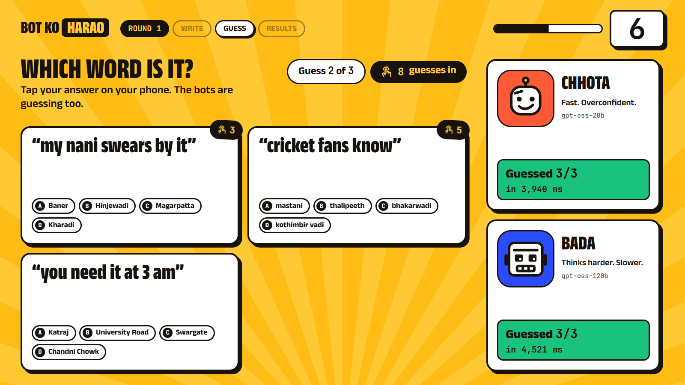
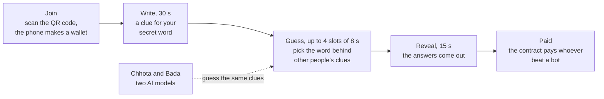
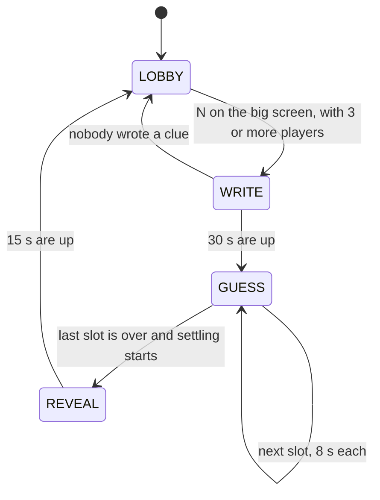
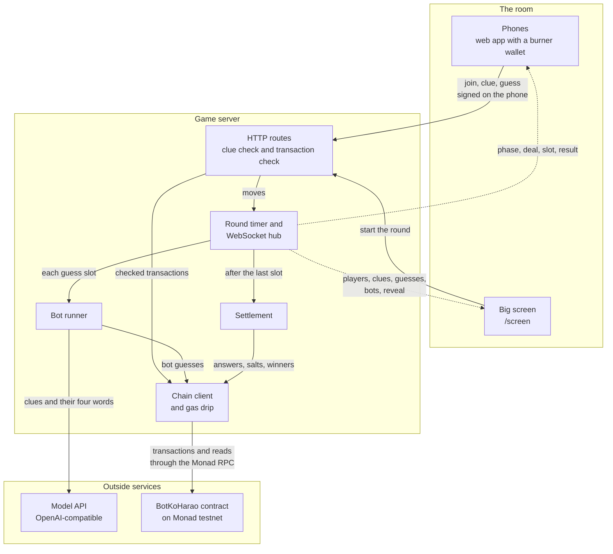
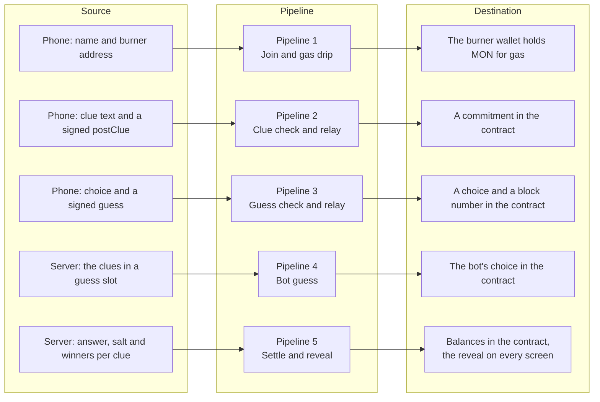
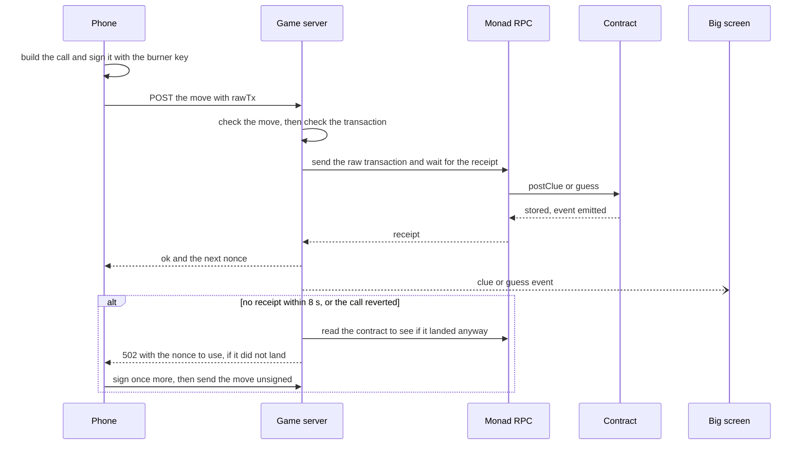
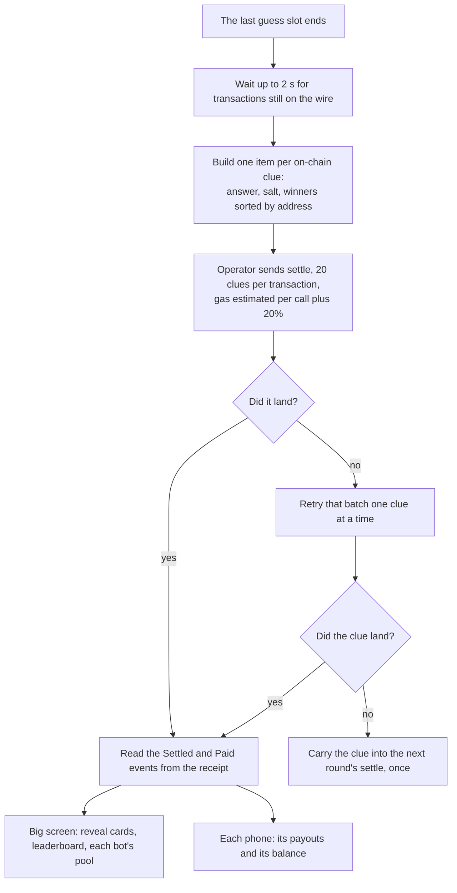
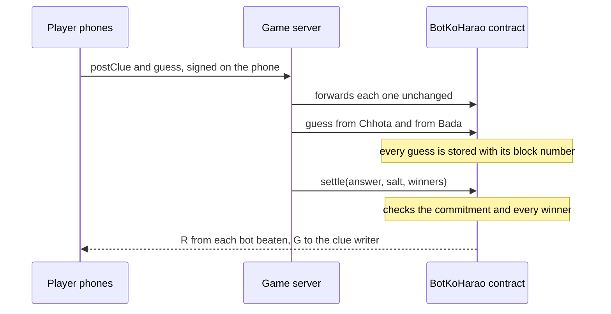

<div align="center">

# Bot ko Harao

**A room full of phones against two AI bots. Beat a bot, and a contract on Monad pays you from its prize pool.**

[](https://testnet.monadvision.com/address/0xe28e2E3eF788CF38dE8623e7173406b4C9673D14)
[](https://testnet.monadvision.com/address/0xe28e2E3eF788CF38dE8623e7173406b4C9673D14)


[Play it](https://bot-ko-harao-production.up.railway.app) · [Big screen](https://bot-ko-harao-production.up.railway.app/screen) · [Contract](https://testnet.monadvision.com/address/0xe28e2E3eF788CF38dE8623e7173406b4C9673D14) · [A settled round](https://testnet.monadvision.com/tx/0x3496a1f38b1aa13a47fb0c71f6ebf3f31cefa95c1d0f2bf6bd9398202303c0d1) · [Run it yourself](#run-it-yourself)



*The big screen in a test round. The players and their clues in this picture are scripted. The two bots are the real models.*

</div>

| | |
|---|---|
| **Play it** | Phones: [bot-ko-harao-production.up.railway.app](https://bot-ko-harao-production.up.railway.app). Big screen: [/screen](https://bot-ko-harao-production.up.railway.app/screen). A round needs 3 players, and **N** on the big screen starts it. |
| **Contract** | [`0xe28e2E3eF788CF38dE8623e7173406b4C9673D14`](https://testnet.monadvision.com/address/0xe28e2E3eF788CF38dE8623e7173406b4C9673D14) on Monad testnet (chain ID 10143). Source verified, exact match, on MonadVision (Monad's Sourcify). |
| **A round on chain** | [Settle transaction](https://testnet.monadvision.com/tx/0x3496a1f38b1aa13a47fb0c71f6ebf3f31cefa95c1d0f2bf6bd9398202303c0d1) of a test round on 10 October 2026. One transaction settled three clues and made 18 payouts. |
| **Demo video** | TODO |
| **Product video** | TODO |
| **Post** | [Build post on X](https://x.com/AdityaPati74270/status/2108824629116887407) |

Built at Monad Blitz Pune V3. [What was built at the event](#built-at-monad-blitz-pune-v3).

## The game in 15 seconds



"Bot ko Harao" is Hindi for "beat the bot". The two bots are Chhota ("small") and Bada ("big").

## System at a glance

| | |
|---|---|
| **Problem** | AI is good at word games but not perfect. A prize for out-thinking a model is usually handed out by a host. Here it is locked in a contract and paid by the contract's rules. |
| **Input** | A player name, a clue of at most 6 words, and guesses (one of four words). Each move is a transaction signed on the phone. |
| **Processing** | One server runs the round timer, checks clues and signed transactions, relays them to Monad, asks two models for their guesses, and proposes the result. The contract checks that result. |
| **Output** | MON paid from each beaten bot's pool, a reveal with a leaderboard on the big screen, and each phone's own winnings. |
| **Runtime** | One Node 22 process: HTTP routes, a WebSocket, and the built web app. |
| **Storage** | The contract on Monad testnet, the server's memory for the round in play, and the phone's local storage for its wallet key. There is no database. |
| **Integrations** | A Monad RPC endpoint and an OpenAI-compatible chat API for each bot (Groq's free tier by default). |
| **Status** | Live on Monad testnet with verified source. A hackathon build: not audited and not on mainnet. |

## Contents

| The game | How it is built | Run it and change it |
|---|---|---|
| [The bet](#the-bet)<br>[How a round works](#how-a-round-works)<br>[What happens on chain](#what-happens-on-chain)<br>[Why Monad](#why-monad)<br>[Who pays](#who-pays)<br>[Built at Monad Blitz Pune V3](#built-at-monad-blitz-pune-v3) | [Architecture](#architecture)<br>[Source, pipeline, destination](#source-pipeline-destination)<br>[Pipelines step by step](#pipelines-step-by-step)<br>[Technology stack](#technology-stack)<br>[Repository map](#repository-map)<br>[Reliability, security and operations](#reliability-security-and-operations) | [Run it yourself](#run-it-yourself)<br>[Settings](#settings)<br>[API reference](#api-reference)<br>[Development and testing](#development-and-testing)<br>[Status](#status)<br>[Limits and troubleshooting](#limits-and-troubleshooting)<br>[Licence and credits](#licence-and-credits) |

## The bet

AI is good at word games, but it is not perfect. In our bench run the small bot got 7 of 30 clues wrong and the big one got 3 of 30 wrong ([results](docs/bench-test-run.md)). A person who knows the room can write a clue that people get and a model misreads. This game pays for exactly that moment, and the payment is enforced by a contract instead of a host.

## How a round works



| Phase | Length | What the player does | What goes on chain |
|---|---|---|---|
| **Join** | before a round | Scans the QR code on the big screen. The phone creates a burner wallet in the browser and its address becomes the player ID. No app and no sign-up. | The game sends that wallet a little MON for gas |
| **Write** | 30 s | Sees four words, one of which is theirs, and writes a clue for it. A clue is at most 6 words and 40 characters and cannot contain any of the four words. | `postClue`, signed on the phone |
| **Guess** | up to 4 slots of 8 s | Gets someone else's clue and its four words. The two bots get the same clues. | `guess`, from each phone and each bot |
| **Reveal** | 15 s | The answers come out and the winnings are settled. | `settle`, from the operator |

The bots are Chhota (`openai/gpt-oss-20b`) and Bada (`openai/gpt-oss-120b`), both on Groq's free tier. Any OpenAI-compatible endpoint works. A bot that times out or errors counts as having given no answer.

In each slot a phone gets one clue. It is never the player's own clue and never one from the player's own group of four words.

## Architecture



Solid arrows are requests and transactions. Dotted arrows are WebSocket pushes.

Phones never talk to the RPC, so a full room is one connection to the chain and one WebSocket back to each phone.

| Part | Runs in | Job | Code |
|---|---|---|---|
| Phone app | The player's browser | Makes the burner wallet, signs `postClue` and `guess`, shows the round | [PhoneView.tsx](web/src/views/PhoneView.tsx) |
| Big screen | The host's browser, at `/screen` | QR code, timer, live clues and guesses, the bots, the reveal. **N** starts a round | [ProjectorView.tsx](web/src/views/ProjectorView.tsx) |
| HTTP routes | Server | Join, clue, guess and start, then settle and reveal | [index.ts](server/src/index.ts) |
| Round timer | Server | The four phases and the guess slots | [game.ts](server/src/game.ts) |
| WebSocket hub | Server | Pushes every change to the phones and the big screen | [ws.ts](server/src/ws.ts) |
| Deal | Server | Four words, a secret answer, a salt and a commitment for each player | [deal.ts](server/src/deal.ts) |
| Checks | Server | The clue rules, and the rules a signed transaction must meet | [moderate.ts](server/src/moderate.ts), [relay.ts](server/src/relay.ts) |
| Bot runner | Server | One model call per bot per slot, then the bot's `guess` transactions | [bots.ts](server/src/bots.ts) |
| Chain client | Server | Wallets, gas limits, fees, relay, settle and reads | [chain.ts](server/src/chain.ts) |
| Gas drip | Server | Sends MON to new burner wallets in batches | [drip.ts](server/src/drip.ts) |
| Settlement | Server | Builds the proposed result, then the cards and the leaderboard | [settle.ts](server/src/settle.ts) |
| Contract | Monad testnet | Stores clues and guesses, checks the result, pays | [BotKoHarao.sol](contracts/src/BotKoHarao.sol) |

## Source, pipeline, destination



| # | Pipeline | Trigger | Input | Destination |
|---|---|---|---|---|
| 1 | Join and gas drip | A player taps Join | JSON: name and wallet address | A seat in the room, and MON for gas in the burner wallet |
| 2 | Clue | A player sends a clue during Write | JSON: clue text and a signed `postClue` | The commitment in the contract, and the clue in the round |
| 3 | Human guess | A player taps a word during Guess | JSON: choice and a signed `guess` | The choice and its block number in the contract |
| 4 | Bot guess | A guess slot opens | The slot's clues, each with its four words | The model API, then the bot's `guess` in the contract |
| 5 | Settle and reveal | The last guess slot ends | Answer, salt and winners for each clue | Balances in the contract, the reveal on the big screen, a result on each phone |

**What is kept where**

| Place | What it holds | How long |
|---|---|---|
| The contract | Each clue's giver, round, word group, commitment and settled flag. Each guess with its block number. Every bot's pool and every player's winnings. | Permanent |
| Contract events | The clue text (`ClueGiven`), each guess (`Guessed`), the revealed answer (`Settled`), every payout (`Paid`), every top-up (`Funded`) | Permanent |
| Server memory | The players, this round's words, answers and salts, the clues, the guesses, the bots' answers, winnings since the server started, the gas drip queue | Until the server restarts |
| The phone's local storage | The burner wallet's private key and the player's name | Until the browser's storage is cleared |
| Sent on, not kept | Signed transactions, WebSocket messages, the prompt sent to the model API | Not kept |

## Pipelines step by step

### 1. Join and gas drip

| Stage | Component | Responsibility | Input → Output | Code |
|---|---|---|---|---|
| 1 | Phone app | Creates the burner key, or loads the saved one | Name typed by the player → `POST /join` | [PhoneView.tsx](web/src/views/PhoneView.tsx) |
| 2 | `POST /join` | Checks the name (letters, digits, space, `-` and `_`, up to 16) and the address. Stops at 80 players | JSON body → a player in memory | [index.ts](server/src/index.ts) |
| 3 | `chainInfo` | Reads the current fees and the wallet's nonce | Address → chain ID, contract, gas limits, fees, nonce | [index.ts](server/src/index.ts), [chain.ts](server/src/chain.ts) |
| 4 | Drip queue | Groups up to 20 new wallets and sends one batch every 2 s. Skips a wallet that already holds half a drip | Address → a `dripMany` transaction | [drip.ts](server/src/drip.ts) |
| 5 | Contract | Forwards the drip wallet's own MON | `dripMany(to, each)` → `DRIP_MON` in each wallet | [BotKoHarao.sol](contracts/src/BotKoHarao.sol) |
| 6 | WebSocket hub | Tells the big screen who is in | → `players` (count and names) | [ws.ts](server/src/ws.ts) |

**If it fails.** A batch that does not land is retried, up to 3 tries per wallet. After that the phone plays off chain: its moves count for the reveal and cannot pay out. A phone that joins twice gets its own seat back, not a second one.

### 2 and 3. A clue or a guess, from tap to block



| Stage | Component | Responsibility | Input → Output | Code |
|---|---|---|---|---|
| 1 | Deal | When Write starts, gives each player four words, a secret index, a random 32-byte salt and the commitment | Players and round → `deal` (words, own index, commitment) | [deal.ts](server/src/deal.ts) |
| 2 | Phone app | Builds the call and signs it: EIP-1559, zero value, the gas limit the server gave | Clue text or choice → `POST` with `rawTx` | [PhoneView.tsx](web/src/views/PhoneView.tsx) |
| 3 | Move check | Clue: at most 40 characters and 6 words, none of the four words, no banned word. Guess: a choice from 0 to 3, not your own clue, one guess per clue | Move → ok or a reason | [moderate.ts](server/src/moderate.ts), [index.ts](server/src/index.ts) |
| 4 | Transaction check | EIP-1559, the right chain, the right contract, zero value, exactly the expected call data, a gas limit no higher than the measured one, signed by that player | `rawTx` → ok or a reason | [relay.ts](server/src/relay.ts) |
| 5 | Relay | Sends the transaction unchanged and waits up to 8 s for the receipt | `rawTx` → receipt | [chain.ts](server/src/chain.ts) |
| 6 | Contract | Stores the commitment under `keccak256(giver, round)`, or the choice with its block number under the clue and the player | Call → `ClueGiven` or `Guessed` | [BotKoHarao.sol](contracts/src/BotKoHarao.sol) |
| 7 | Round state | Adds the move to the round and tells the big screen | → `clue` (count, who) or `guess` (who, relay time, block) | [index.ts](server/src/index.ts) |

| | Clue | Guess |
|---|---|---|
| Route | `POST /clue/submit` | `POST /guess` |
| Contract call | `postClue(round, group, commit, text)` | `guess(clueId, choice)` |
| Gas limit | 101,916 (measured 84,930 plus 20%) | 74,474 (measured 62,061 plus 20%) |
| Kept on chain | The commitment. The text is in the event | The choice and the block number |

**If it fails.** If no receipt comes back, the server reads the contract, and a move that landed anyway still counts. If it did not land, the phone gets the nonce to use and signs once more. If that fails too, the move is sent without a transaction. It then counts for the reveal and cannot pay out.

### 4. Bot guess

| Stage | Component | Responsibility | Input → Output | Code |
|---|---|---|---|---|
| 1 | Round timer | Opens a guess slot. Both bots start at once | The slot's clues → two runs side by side | [game.ts](server/src/game.ts), [index.ts](server/src/index.ts) |
| 2 | Prompt | One chat request per bot per slot, with every clue in the slot: its ID, its text and its four numbered words | Clues → a chat completion request | [bots.ts](server/src/bots.ts) |
| 3 | Model API | Answers within 4 s for Chhota and 8 s for Bada, or the bot has no answer | Request → JSON with one choice per clue | [config.ts](server/src/config.ts) |
| 4 | Parse | Keeps answers for clues in this slot with a choice from 0 to 3 | Reply text → answers | [bots.ts](server/src/bots.ts) |
| 5 | Bot wallet | Sends one `guess` per clue that is on chain, with the measured gas limit | Answers → `guess` transactions | [chain.ts](server/src/chain.ts) |
| 6 | WebSocket hub | Tells the big screen how long the bot took and how many clues it answered, not whether it was right | → `bot` (name, think time, count) | [index.ts](server/src/index.ts) |

**If it fails.** A timeout, an API error, a reply that is not JSON or a missing API key all end the same way: the bot gives no answer for that slot and the round goes on. The contract counts a silent bot as beaten.

### 5. Settle and reveal



| Stage | Component | Responsibility | Input → Output | Code |
|---|---|---|---|---|
| 1 | Round timer | Ends the last slot and starts the 15 s reveal | → `settle-needed` | [game.ts](server/src/game.ts) |
| 2 | Proposal | One item per on-chain clue. The winners are the humans whose on-chain guess was right, sorted by address | Round state → a list of settlements | [settle.ts](server/src/settle.ts) |
| 3 | Operator wallet | Sends `settle` in batches of 20 clues | Settlements → a transaction | [chain.ts](server/src/chain.ts) |
| 4 | Contract | Checks the commitment and every winner, then moves R and G out of the bots' pools | `settle(items)` → `Settled` and `Paid` | [BotKoHarao.sol](contracts/src/BotKoHarao.sol) |
| 5 | Read back | Takes the payouts and which bots were right from the events, and each bot's pool from `balanceOf` | Receipt → payments | [index.ts](server/src/index.ts) |
| 6 | Reveal | Up to three cards (a clue that beat both bots, a clue nobody got, a clue a bot got), the top 10 earners, how many clues have beaten the bots, and the settle transaction's hash and block | → `reveal` to the big screen | [settle.ts](server/src/settle.ts) |
| 7 | Result | Each phone's payout lines and balance, with a link to the settle transaction | → `result` to that phone | [index.ts](server/src/index.ts) |

**If it fails.** A batch that does not go through is retried clue by clue, so one bad item cannot hold back everyone else's payout. A clue that still fails is tried once more with the next round. With no contract set, the reveal still goes out and nothing is paid.

## What happens on chain



The server proposes a result and the contract checks it. The server never chooses who gets paid or how much.

Each phone signs its own transactions with its burner wallet. The server forwards a transaction only if it is exactly the call the game expects from that player: the right signer, the right contract, the right data, no value, and a gas limit no higher than the measured one. It cannot change a signed transaction.

| Function | Who can call it | What it does | Reverts with |
|---|---|---|---|
| `postClue` | Any wallet | Stores a commitment to the answer, `keccak256(giver, round, answer, salt)`. The answer itself is not on chain until the round is settled. One clue per player per round. | `DUPE_CLUE` |
| `guess` | Any wallet but the clue's writer | Records the choice and the block number, once per player per clue. | `NO_CLUE`, `SETTLED`, `OWN_CLUE`, `BAD_CHOICE`, `DUPE_GUESS` |
| `settle` | The operator | Reveals the answer and salt. The contract rejects the call if they do not match the commitment, or if any listed winner did not actually guess right. | `NOT_OP`, `NO_CLUE`, `SETTLED`, `BAD_COMMIT`, `UNSORTED`, `GIVER_WIN`, `BOT_WIN`, `NOT_WINNER` |
| `fund(bot)` | Anyone | Adds MON to a bot's prize pool. | `NOT_BOT` |
| `withdraw` | Any player | Pays a player their winnings. Bots cannot withdraw. The phone app shows winnings but has no withdraw button yet. | `BOT_NO_WD`, `NO_BAL`, `WD_FAIL` |
| `dripMany` | Anyone | Forwards the caller's own MON to a list of addresses, so burner wallets have gas. | `LOW_VALUE`, `DRIP_FAIL` |

**The payout rules**

- Each human who was right takes **R** from each bot they beat. A bot is beaten if it was wrong, did not answer, or answered in a later block. A tie in the same block goes to the human.
- If at least one human was right, the clue's writer takes **G** from each bot that was wrong or did not answer.
- R and G are fixed when the contract is deployed. On the live contract R is 0.005 MON and G is 0.01 MON.
- A bot pays only what is left in its pool.

## Why Monad

- **A whole room writes at once.** A clue's ID is `keccak256(giver, round)` and each guess has its own slot keyed by clue and player. There is no shared counter, so transactions from different phones never write to the same storage slot and can run in parallel.
- **Every guess lands while the round is still on screen.** Testnet was producing about three blocks a second when we measured. Each guess is stored with the block it landed in, and a correct human guess is paid by a bot unless that bot's own correct guess is in an earlier block. The server relays both the players' and the bots' guesses, so this is a rule about what landed on chain, not a stopwatch.
- **Small payouts, many of them.** A correct guess is worth a fraction of a MON. That only makes sense where a transaction costs far less than the prize.
- **Gas limits are measured.** Monad charges for the gas limit, not the gas used. Every limit the game sets is a measured cost plus 20%, never a round number.

## Who pays

- A sponsor puts up the prize for beating a bot, with `fund(bot)`.
- The pool pays out only when a person in the room beats that bot.
- The host cannot pick the winners. Payout sizes are fixed at deploy, and the operator can only submit a result that the contract checks.
- Planned, not in the contract yet: a cut of each sponsored pool. The first customers are event organisers and sponsors who already hand out prizes by hand.
- After events: AI companies already pay people who find where their models fail. Anthropic, for example, [pays for jailbreaks of its models](https://www.anthropic.com/news/model-safety-bug-bounty) through HackerOne. This contract is the same deal in small. The prize is put up first and paid only when a human provably beats the model. It fits any test where the right answer can be committed before anyone plays.

## Technology stack

| Role | Technology | Used for |
|---|---|---|
| Contract | Solidity 0.8.28, Foundry (the Monad build), forge-std | The game rules, their tests and the deploy script |
| Chain | Monad testnet, chain ID 10143. MonadVision and Sourcify | Where the contract runs, and where its source is verified |
| Server | Node 22, TypeScript run by tsx, Express 4, ws 8, dotenv | HTTP routes, WebSocket push, the round timer |
| Chain client | viem 2 | Signing on the phone. Relay, gas estimates, reads and event parsing on the server |
| Bots | The openai SDK 4 against Groq's OpenAI-compatible API | `openai/gpt-oss-20b` for Chhota and `openai/gpt-oss-120b` for Bada |
| Web | React 19, Vite 8, Tailwind CSS 4, qrcode.react, Phosphor icons | The phone app and the big screen |
| Tests and lint | Foundry tests, Vitest 3, oxlint | The contract, the server's logic, the web code |
| Hosting | Railway | The public game: one Node process that redeploys on every push to `main` |

## Repository map

```text
bot-ko-harao/
├── contracts/                    Solidity, built and tested with Foundry
│   ├── src/BotKoHarao.sol        the contract
│   ├── test/BotKoHarao.t.sol     its tests
│   ├── script/Deploy.s.sol       deploys, and can fund both bots
│   ├── foundry.toml              solc 0.8.28, the Monad network, Sourcify
│   └── lib/forge-std/            git submodule
├── server/                       the game server
│   ├── src/
│   │   ├── index.ts              HTTP routes, round wiring, settle and reveal
│   │   ├── game.ts               the round timer and its phases
│   │   ├── ws.ts                 WebSocket hub
│   │   ├── deal.ts               words, salts, commitments, clue IDs
│   │   ├── moderate.ts           clue rules
│   │   ├── relay.ts              signed transaction rules
│   │   ├── chain.ts              wallets, gas limits, relay, settle, reads
│   │   ├── drip.ts               gas for new burner wallets
│   │   ├── bots.ts               model calls and bot guesses
│   │   ├── settle.ts             settlement proposal, cards, leaderboard
│   │   └── config.ts             settings read from server/.env
│   └── tests/                    Vitest: deal, moderate, relay, settle
├── web/                          the phone app and the big screen
│   └── src/
│       ├── App.tsx               "/" is the phone, "/screen" is the big screen
│       ├── views/                PhoneView.tsx, ProjectorView.tsx
│       ├── components/           the bots' faces, the timer
│       └── hooks/useWs.ts        WebSocket that reconnects
├── data/
│   ├── wordpack.json             36 playable groups of four words
│   └── banned-words.txt
├── docs/                         original spec, architecture notes, bench results
├── .env.example                  every setting, with comments
└── package.json                  build, start and test for the whole repo
```

- [contracts/](contracts/): the Solidity contract and tests (Foundry)
- [server/](server/): the game server (Node, TypeScript, Express, ws, viem)
- [web/](web/): the phone and big-screen app (Vite, React)
- [data/](data/): the word pack and banned-word list
- [docs/](docs/): the original [spec](docs/spec.md) and [architecture notes](docs/architecture.md), and the [bench results](docs/bench-test-run.md). Where they differ from this README, the README is current.

## Run it yourself

You need Node 22 and npm. Foundry is only needed for the contract, and we use the Monad build (`foundryup --network monad`).

| To do this | You need |
|---|---|
| Play off chain on your own computer | Node 22, npm, git |
| Turn on the bots | A free Groq key, or any OpenAI-compatible endpoint |
| Play for MON on testnet | Foundry (the Monad build), four testnet wallets and testnet MON |

**1. Start the game**

```bash
git clone --recurse-submodules https://github.com/Aditya-Patil27/bot-ko-harao.git
cd bot-ko-harao
npm run build                   # installs and builds web/ and server/
cp .env.example server/.env     # Windows: copy .env.example server\.env
npm start                       # http://localhost:3001
```

One process serves the phone app, the big screen and the API.

- Big screen: `http://localhost:3001/screen`
- Players: `http://localhost:3001`
- For phones on the same Wi-Fi, open both with your computer's IP address in place of `localhost`. The QR code then points at that address.
- A round needs at least 3 players. The burner wallet lives in the browser's local storage, so each player needs their own device or browser profile.
- Press **N** on the big screen to start the round.

With the example file as it is, the game runs off chain: the same rounds, with no payouts. The bots have no key yet, so they give no answer and every clue the room gets right counts as beating them. The server says at startup which bots have no key.

**2. Turn on the bots**

Put a free Groq key (console.groq.com) in `BOT_CHHOTA_API_KEY` and `BOT_BADA_API_KEY` in `server/.env`, then restart. A bot with an empty key is never called, so for a local endpoint that needs no key, put any value there.

**3. Play for MON on testnet**

Fill in `OPERATOR_PK`, `DRIP_PK`, `BOT_CHHOTA_PK` and `BOT_BADA_PK` in `server/.env` with four testnet wallets. All four need testnet MON for gas, and the operator also pays for the deploy and the bots' prize pools. Then deploy your own contract with the same values exported in your shell:

```bash
cd contracts
export MONAD_RPC_HTTP=https://testnet-rpc.monad.xyz
export OPERATOR_PK=0x... BOT_CHHOTA_PK=0x... BOT_BADA_PK=0x...
export BOT_BANKROLL_WEI=500000000000000000    # optional: 0.5 MON into each bot's pool
forge script script/Deploy.s.sol --rpc-url monad --broadcast
```

Put the printed address in `CONTRACT_ADDRESS` and restart the server. Settling is operator-only, so you need your own contract to run your own game.

**Tests**

```bash
cd server && npm test          # 29 tests
cd contracts && forge test     # 24 tests
```

## Settings

All server settings are read from `server/.env`. The full list with comments is in [.env.example](.env.example).

| Variable | What it does | Needed? | Example |
|---|---|---|---|
| `PORT` | The port the server listens on | No, default 3001 | `3001` |
| `PUBLIC_URL` | The address shown as the QR code. If it is empty or a localhost address, the big screen uses the address it was opened with | For a hosted game | `https://game.example.com` |
| `MONAD_RPC_HTTP` | Monad RPC endpoint | To play on chain | `https://testnet-rpc.monad.xyz` |
| `CHAIN_ID` | Chain ID | No, default 10143 | `10143` |
| `CONTRACT_ADDRESS` | The deployed `BotKoHarao` contract. Empty means the game runs off chain | To play on chain | `0x...` |
| `EXPLORER_TX_URL` | The explorer address a settle transaction's hash is added to, for the link on the results. Empty means no link | No, default MonadVision | `https://testnet.monadvision.com/tx/` |
| `OPERATOR_PK` | Deploys the contract and settles rounds | To play on chain | `0x...` |
| `DRIP_PK` | Sends gas to burner wallets | To play on chain | `0x...` |
| `BOT_CHHOTA_PK`, `BOT_BADA_PK` | The two bots' wallets | To play on chain | `0x...` |
| `BOT_*_API_KEY` | The key for the bot's model API. Empty means the bot is never called | For the bots to answer | `your-key` |
| `BOT_*_BASE_URL` | The OpenAI-compatible endpoint behind the bot | No, default Groq | `https://api.groq.com/openai/v1` |
| `BOT_*_MODEL` | The model behind the bot | No | `openai/gpt-oss-20b` |
| `BOT_*_REASONING` | The reasoning effort sent to the model | No, default `low` | `low` |
| `DRIP_MON` | Gas sent to each new player | No, default 0.25 | `0.25` |
| `WRITE_S`, `SLOT_S`, `SLOTS` | Round timings: seconds to write, seconds per guess slot, number of slots | No, default 30, 8 and 4 | `30` |
| `DEMO_MODE` | `1` shortens the timers to 25 s to write and 3 slots of 7 s | No | `0` |

The deploy script reads its values from your shell, not from `server/.env`:

| Variable | What it does | Needed? | Example |
|---|---|---|---|
| `MONAD_RPC_HTTP` | The RPC behind `--rpc-url monad` | Yes | `https://testnet-rpc.monad.xyz` |
| `OPERATOR_PK` | The wallet that deploys and becomes the operator | Yes | `0x...` |
| `BOT_CHHOTA_PK`, `BOT_BADA_PK` | The bots' wallets. Their addresses are fixed in the contract | Yes | `0x...` |
| `PAY_R_WEI`, `PAY_G_WEI` | Payout sizes, in wei | No, default 0.02 and 0.05 MON | `5000000000000000` |
| `BOT_BANKROLL_WEI` | MON put into each bot's pool in the same run | No | `500000000000000000` |

`MONAD_RPC_WSS` is in the example file and the server does not use it. `OMNIROUTE_*` and `FREELLMAPI_*` are notes for pointing a bot's `BASE_URL` at a local router by hand. The server does not read them.

Never commit `.env`. It holds private keys.

## API reference

**HTTP.** Bodies and replies are JSON. Bodies are capped at 4 kB.

| Route | Called by | Body | Reply | Errors |
|---|---|---|---|---|
| `POST /join` | Phone | `name`, `address` | `playerId`, `config` (`writeS`, `slotS`, `slots`), `chain` | 400 `invalid name`, `invalid address`. 409 `already joined` (with the same `playerId`), `room is full` |
| `GET /state` | Phone, big screen | none | `phase`, `round`, `endsAt`, `playerCount`, `names`, `publicUrl` | none |
| `POST /start` | Big screen | none | `ok`, `round`. A round starts only from the lobby with 3 or more players | none |
| `POST /clue/submit` | Phone | `playerId`, `text`, `rawTx` (optional) | `ok`, `clueId`, `onChain`, `nonce` | 400 with the reason. 409 `already submitted`. 502 `tx failed` with the `nonce` to use |
| `POST /guess` | Phone | `playerId`, `clueId`, `choice` (0 to 3), `rawTx` (optional) | `ok`, `nonce`, and `ms` and `block` when the transaction landed | 400 with the reason. 409 `already guessed`. 502 `tx failed` with the `nonce` to use |
| `POST /clue/check` | Nothing in the web app | `text`, `options` | `ok`, and a `reason` if the clue breaks a rule | 400 |
| `GET /screen` | Browser | none | The big-screen page | none |

`chain` is what a phone needs to sign: `id`, `contract`, `gas` (`postClue`, `guess`), `maxFeePerGas`, `maxPriorityFeePerGas` and `nonce`. It is `null` when the game runs off chain.

**WebSocket.** Connect to `/ws?role=phone` or `/ws?role=projector`. A phone sends one message, `{ "type": "identify", "playerId": "0x..." }`, so the server knows which socket is whose. Everything else flows from the server.

| Event | Sent to | Fields |
|---|---|---|
| `phase` | Everyone | `name`, `round`, `endsAt` |
| `deal` | One phone | `round`, `group`, `options`, `mine`, `commit` |
| `slot` | One phone | `round`, `slot`, `slots`, `endsAt`, and the clue to guess: `clueId`, `text`, `options` |
| `slot` | Big screen | `round`, `slot`, `slots`, `endsAt`, `clues` |
| `players` | Big screen | `count`, `names` |
| `clue` | Big screen | `count`, `who` |
| `guess` | Big screen | `clueId`, `who`, and `ms` and `block` when the transaction landed |
| `bot` | Big screen | `name`, `thinkMs`, `answeredCount` |
| `reveal` | Big screen | `round`, `cards`, `leaderboard`, `beatCount`, and `bots` (each pool before and after) when on chain. Once the settle transaction has landed, also `tx` (its hash), `block` and `txUrl` (its explorer page) |
| `result` | One phone | `payouts` (`label`, `amount`), `balance`, and the same `tx`, `block` and `txUrl`. On chain only |

**Contract.** The functions are in [What happens on chain](#what-happens-on-chain). The public reads are `clues(clueId)`, `guessOf(clueId, player)`, `balanceOf(address)`, `bots(index)`, `R()`, `G()` and `operator()`.

## Reliability, security and operations

**What is in place**

| Concern | What the code does | Code |
|---|---|---|
| Who gets paid | The contract checks the commitment and every winner. The server cannot name a winner who did not guess right on chain | [BotKoHarao.sol](contracts/src/BotKoHarao.sol) |
| Relayed transactions | Only the exact call the game expects, signed by that player's own wallet, is sent on | [relay.ts](server/src/relay.ts) |
| Input | A 4 kB body cap, name and address checks, the clue rules and a banned-word list | [index.ts](server/src/index.ts), [moderate.ts](server/src/moderate.ts) |
| Gas | Limits are the measured cost plus 20%. `settle` is estimated for every call | [chain.ts](server/src/chain.ts) |
| A slow or failing bot | Timeouts of 4 s and 8 s. A bot that fails gives no answer and the round goes on | [bots.ts](server/src/bots.ts) |
| A lost receipt | The server reads the contract to see whether the move landed | [index.ts](server/src/index.ts) |
| A failed settle | Retried clue by clue, then once more with the next round | [index.ts](server/src/index.ts) |
| Gas drip | Up to 3 tries per wallet. A wallet that already holds half a drip is not paid twice | [drip.ts](server/src/drip.ts) |
| A dropped phone | The socket reconnects after 1 s, and during Write the phone gets its words again | [useWs.ts](web/src/hooks/useWs.ts), [index.ts](server/src/index.ts) |
| A server restart | A returning wallet keeps its balance on screen, and round numbers it already used on chain are skipped | [index.ts](server/src/index.ts), [deal.ts](server/src/deal.ts) |
| Secrets | Keys live in `server/.env`, which git ignores. A burner key never leaves its phone | [.gitignore](.gitignore) |

**Known gaps**

- There is no login for the host. `POST /start` is open, so anyone with the address can start a round.
- A move sent without a signed transaction is accepted on the player ID alone. Such a move can never pay out.
- The round lives in the server's memory. A restart or a redeploy empties the room. There is no database.
- There is no rate limit on the HTTP routes.
- The contract has not been audited and runs on testnet only.
- The burner key sits unencrypted in the browser's local storage. That is fine for testnet gas and not for real funds.
- Logs go to the console and there are no metrics. `GET /state` is the only way to ask the server how it is.
- The repo has no CI, no Dockerfile and no licence file.

**Running it**

- One command, `npm start`, serves everything on one port.
- At startup the server prints whether it is on chain, which bots have no key, and whether demo mode is on.
- The operator, drip and bot wallets pay their own gas. The drip wallet also pays `DRIP_MON` for each new player, so keep it topped up.
- The example file notes that the public RPC is for small rooms. Use a private RPC for a full room.
- The public game is on Railway and redeploys on every push to `main`. A redeploy restarts the server.

## Development and testing

| Task | Command | Notes |
|---|---|---|
| Server with reload | `npm run dev:server` | `tsx watch`, on port 3001 |
| Web with hot reload | `npm run dev:web` | Vite. It passes the API routes and `/ws` on to `localhost:3001` |
| Install and build | `npm run build` | Installs `web/` and `server/` and builds the web app |
| Server tests | `cd server && npm test` | Vitest, 29 tests: the deal, the guess slots, the clue rules, the transaction rules, settlement |
| Contract tests | `cd contracts && forge test` | 24 tests |
| Gas report | `cd contracts && forge test --gas-report` | Where the gas limits in [chain.ts](server/src/chain.ts) come from |
| All tests | `npm test` | Runs both. Needs `forge` on your PATH |
| Lint the web code | `cd web && npm run lint` | oxlint |

There is no CI. Run the tests before you push.

## Status

| Area | State |
|---|---|
| Contract on Monad testnet | Live, source verified |
| Phones sign their own moves, the server checks and relays them | Working |
| Gas for new players | Working |
| Settle and payouts on chain | Working. See the [settle transaction](https://testnet.monadvision.com/tx/0x3496a1f38b1aa13a47fb0c71f6ebf3f31cefa95c1d0f2bf6bd9398202303c0d1) |
| Two bots on live models | Working |
| Phone app and big screen | Working |
| Withdraw button on the phone | Not built yet. `withdraw()` is in the contract |
| A cut of each sponsored pool | Planned, not in the contract |
| Host login, saved rooms, mainnet | Not built |

## Limits and troubleshooting

| Limit | Value |
|---|---|
| Players in a room | 3 to start a round, 80 at most |
| Name | Letters, digits, space, `-` and `_`, up to 16 characters |
| Clue | 6 words and 40 characters, one per player per round |
| Guess | One per player per clue, never on your own clue |
| Guess slots | Up to 4 per round, and no more than the number of clues |
| Word groups | 36. The word pack has 40 entries, and the server skips the 4 that were never filled in |

| What you see | Why | What to do |
|---|---|---|
| `Off chain: CONTRACT_ADDRESS is not set` at startup | No contract in `server/.env` | Fine for a local game. For payouts, deploy and set `CONTRACT_ADDRESS` |
| `Chhota has no API key and will give no answer` | The bot's key is empty | Set `BOT_CHHOTA_API_KEY` and `BOT_BADA_API_KEY`, then restart |
| **N** does nothing | Fewer than 3 players, or a round is already running | Wait for 3 names on the big screen |
| Phones cannot open the QR address | The big screen was opened on `localhost` | Open the big screen with your computer's IP address, or set `PUBLIC_URL` |
| Two tabs play as the same person | Tabs in one browser share one burner wallet | Use another device or browser profile |
| A phone plays but is never paid | Its wallet has no gas, so its moves went in unsigned. The server logs `[drip] giving up` | Check that the drip wallet has MON |
| Everyone is back in the lobby with no names | The server restarted | Join again. Winnings already in the contract are safe |
| `forge` is not found when you run `npm test` | Foundry is not installed or not on your PATH | Install the Monad build, or run only `cd server && npm test` |
| `forge build` cannot find `forge-std` | The repo was cloned without submodules | `git submodule update --init` |
| `export` fails on Windows | The deploy steps are written for a POSIX shell | Use Git Bash, or `$env:NAME = "value"` in PowerShell |

## Built at Monad Blitz Pune V3

Before the event started we had a test build: the contract and its tests, a first deploy to Monad testnet that morning, the phone and big-screen views, and a game server that ran the rounds. The only thing that server could put on chain was a bot's guess. It did not post clues, relay phone transactions, send gas to players or settle. The build was there to test the idea, including the bench run of the bots.

Built at the event, 10 October 2026:

- Deployed the contract the game runs on, at 11:55 IST, and verified the source on MonadVision (Monad's Sourcify).
- Phones sign their own `postClue` and `guess` transactions with the burner wallet. The server checks each one and relays it.
- New players get gas on joining. The drip wallet funds burner wallets in batches through `dripMany`.
- Rounds settle on chain. The server proposes the winners and the contract checks and pays. The reveal cards, the leaderboard and each phone's payout are read from the contract's `Settled` and `Paid` events. Each phone's balance and each bot's remaining pool are read from the contract too.
- Played a full test round on testnet: three clues, twelve guesses, and one settle transaction that made 18 payouts.
- Gas limits measured under Monad pricing, plus 20%.
- A deploy script, and one server process that serves the whole app, so one URL is enough. `npm run build` and `npm start` at the repo root are all a host needs.

## Licence and credits

- **Licence.** The repo has no licence file. The Solidity files carry an `SPDX-License-Identifier: MIT` header. Nothing else states a licence.
- **Contributing.** There is no contribution guide yet.
- **Credits.** Built at Monad Blitz Pune V3 on Monad testnet, with Foundry, viem, Express, ws, React and Vite. The bots run on models served by Groq.
